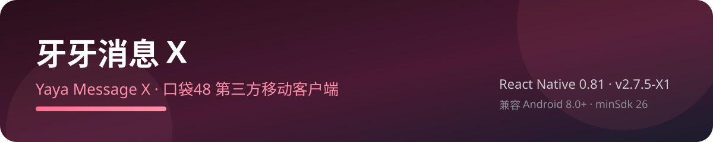

<p align="center">
  
</p>
<p align="center">
  
</p>

<p align="center">
  <a href="LICENSE"></a>
  <a href="https://github.com/xuqinghhh/yaya_msg_mobile/releases"></a>
  
</p>

# 牙牙消息 X

口袋48 第三方移动客户端（React Native）。

**牙牙消息 X** 是牙牙消息的独立衍生分支：上游为 [Xenia0922/yaya_msg_mobile](https://github.com/Xenia0922/yaya_msg_mobile)（源头 [yk1z/yaya_msg](https://github.com/yk1z/yaya_msg)），自 v2.7.5 起由 [@xuqinghhh](https://github.com/xuqinghhh) 独立维护，更新路线与上游分离。

> **⚠️ 重要：由于版本更新较大，建议每一位用户卸载后重新安装软件！**

## 牙牙消息 X 更新内容（相对上游 v2.7.5）

### 新功能

**全局横屏**
- 解除全应用竖屏锁：Android `screenOrientation` 交还系统，横竖屏跟随用户旋转
- 旋转不重建 Activity：`configChanges` 补齐 `smallestScreenSize`，系统自由窗口/侧边条小窗下不再触发 JS 重启导致播放器退出
- 播放器横屏专用布局：视频铺满，顶栏 / 底栏 / 右侧快捷栏按横屏重新分组
- 弹幕改全屏飘屏覆盖层，可随时开关（设置持久化，重启保留）
- 登录页之外全场景横屏；账号设置页横屏下表单限宽 560 居中，不再被拉伸

**播放器 / 直播**
- 在线人数：顶栏显示「N 人在线」，取官方 `getLiveOne.content.onlineNum`，直播 30s 轮询、录播显示该场结束时的数值
- 直播公告按钮：顶栏左上新增喇叭按钮，公告收起后可随时重看；无公告文本时按钮触发刷新拉取
- 成员回放面板：房间内新增「直播回放」入口，按成员过滤口袋回放接口（兼容 `next=0` 带 `userId` 查不到数据的官方行为），列表 + 分页
- 回放进度记忆：每场回放每 5s 记录进度，重进同一场超过 15s 自动 seek 续播并有 toast 提示（上限 200 条 LRU 淘汰）
- B站直播：进直播间自动横屏 + 全屏沉浸真正生效（上游实现写入的是从不参与渲染的本地状态）；解析直播流期间改为纯黑占位，不再闪加载圈

**房间**
- 房间未读角标：官方没有房间级未读接口，采用本地累计方案，三条通道互补（云信实时消息累计 / 最新消息时间比对 / 内容指纹比对），任一命中即亮，避免「有新消息却看不到标注」
- 首页「正在直播」改为一行四张小卡网格（总高不超过屏高 1/3），替代原来的全宽 banner 轮播；卡片显示队伍徽章
- 「最近播放」卡支持 ❌ 关闭单曲，且持久化——重启后不再冒出来

**公演**
- 「即将开演」横向公演卡条：公演记录页与首页「公演直播」区块共用同一组件（数据同源、行为一致）
- 数据源为 Seine 互动列表公演排期（无需 token），可覆盖未来 10 天场次
- 60s 心跳：到点自动把时间徽标翻成「直播中」，点击已开演场次直接进对应团的 B站直播间
- 队徽文件名反推「团 + 队」，队伍主色自动着色；排期 10 分钟缓存、B站房间配置 5 分钟缓存

### 问题修复

- **直播公告串场**：切换到没有公告的直播间时，不再显示上一个直播间的旧公告（解析新直播前先清空公告状态）
- **弹幕「关了还飘」**：弹幕总开关改用持久化的弹幕设置——上游实现里开关存在 `playerStore.danmakuOn`，每次打开播放器都被强制重置为开
- **弹幕串台**：切换直播间时清空上一间残留的弹幕列表与飘屏
- **系统小窗（PiP）中断直播**：进 PiP 时 Android 的 AppState 会报 `background`，导致「释放横屏锁、停弹幕/聊天轮询」等后台分支误触发、与转场竞争——PiP 事件改为同步发出并用 `isPipActive()` 豁免
- **PiP 进入不平滑**：Android 12+ 启用 `setAutoEnterEnabled`，播放中上滑/Home 直接无缝缩放进画中画
- **首页关注成员只显示 2 个**：列表截断（slice 8 个）发生在「关注优先」排序之前，排在接口原始顺序后面的关注成员被直接丢掉
- **B站返回误现加载圈**：返回转场期间组件仍挂载且候选流已清空，误渲染「正在进入直播间…」全屏分支——返回前先清掉路由参数
- **房间未读时间基线**：改用服务器消息时间做「已读到哪」基线——上游时代用设备时钟 `Date.now()`，设备时钟比服务器快几秒角标就永不出现，且重启也无法恢复
- **死代码清理**：删除全仓零调用的 `enterPipMode()` 与未使用样式，修正与实现不符的注释

### 性能优化

- 直播/录播封面缩略图请求从 700px 降到 400px（四列网格单卡仅 ~300px 宽，原图 oversized 约 2.3 倍）；首页直播卡 1080 → 300
- 房间列表轮询瘦身：30s 一轮的 `loadFollowed` 里，最重的直播状态请求（`getLiveList size:100`，仅为点亮「直播中」标）改为 2.5 分钟节流；驱动未读的消息请求保持 30s
- 内存防膨胀：回放进度 200 条 LRU、未读计数单房间上限 999、指纹长度上限 2KB、旧版本存储键自动清理

### 品牌 / 构建

- 应用更名「牙牙消息 X」，全套新图标 / 启动图 / logo（资源体积压缩约 60%）
- Gradle Wrapper 与构建脚本更新；versionCode 2075023
- 英 / 日 / 韩 / 繁四语言文案同步

> **已知限制**：B站直播不显示在线人数——实测 `room/v1/Room/get_info` 的 `online` 恒为 0，`getInfoByRoom` 未登录时被风控返回 -352，实时数据源不存在；房间未读为本地累计方案，App 未运行期间的消息不计入。

## 功能

- 房间消息 / 私信 / 翻牌
- 口袋直播与回放
- 公演主播（B站直播）
- 官方音乐库
- 翻牌统计、成员数据库、鸡腿充值

## 安装
从 [Releases](https://github.com/xuqinghhh/yaya_msg_mobile/releases) 下载：

- `yaya-msg-x-universal.apk`：通用包（全 ABI，体积最大）
- `yaya-msg-x-x64.apk`：x86_64 模拟器专用
- `yaya-msg-x-v8a.apk` / `-v7a.apk`：真机包（**推荐真机使用**，比通用包小约 40%）

模拟器请用 x64 包，否则无法启动。App 内「检查更新」始终提供通用包直链，真机如需最小体积请在 Release 页面按架构下载。

## 构建

```sh
npm install --legacy-peer-deps
node scripts/build-apk.js
```

## 兼容

Android 8.0+（minSdk 26）。

## 已知问题

-

## 致谢

- [yk1z/yaya_msg](https://github.com/yk1z/yaya_msg)：本项目最初的源头，感谢原作者的开发与贡献；
- [Xenia0922/yaya_msg_mobile](https://github.com/Xenia0922/yaya_msg_mobile)：本项目的直接上游基础，感谢其二次开发工作。

本项目按 GPL-3.0 协议开源，在上述项目基础上继续开发。

## 免责声明

本应用为**非官方第三方客户端**，与丝芭传媒（SNH48 Group）及口袋48官方无任何关联，未获得其授权或认可，请以官方客户端为准。

- 应用展示的直播、视频、音乐、图片、文本等内容的版权归原权利人所有；
- 本应用仅为个人技术学习与交流目的开发，不代表任何官方立场，不保证内容持续可用；
- 请勿将本应用及其中内容用于商业用途或任何盈利活动；
- 使用本应用可能产生的任何风险（含账号安全风险）由使用者自行承担；
- 如内容涉及侵权或您认为不妥，请与仓库维护者联系处理。
