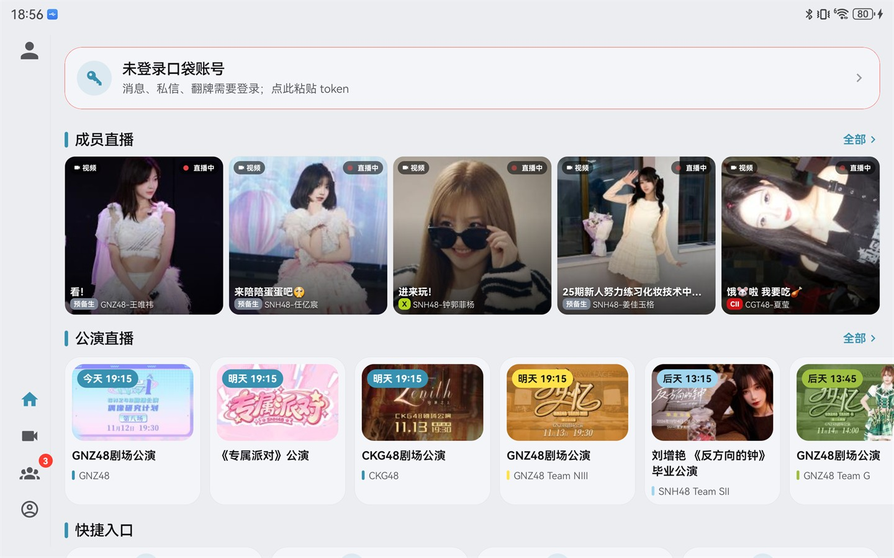
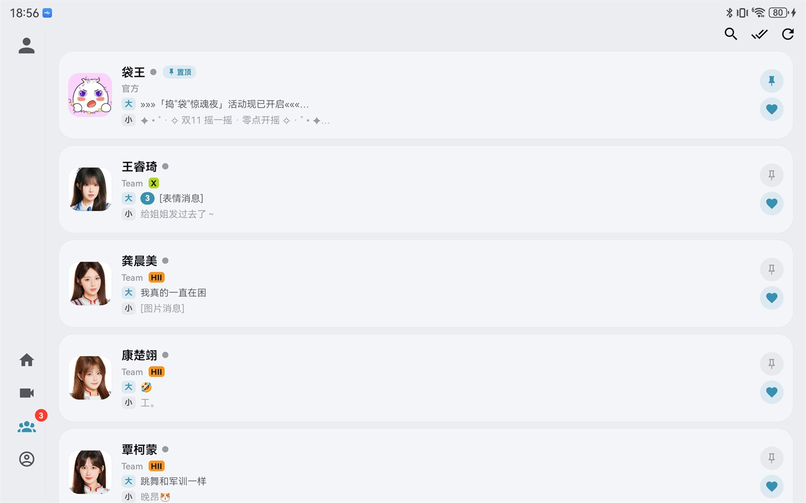
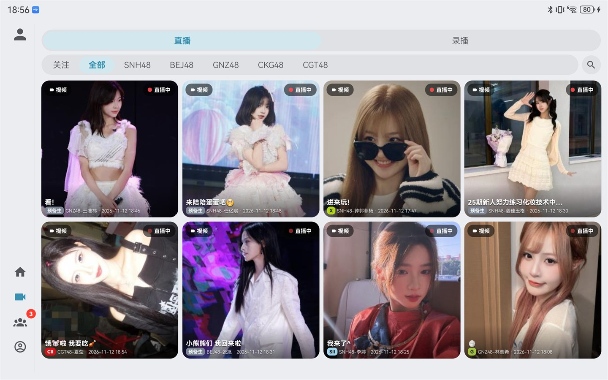
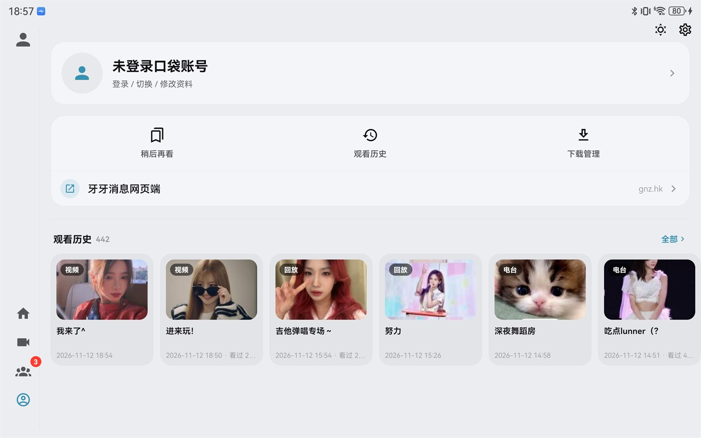
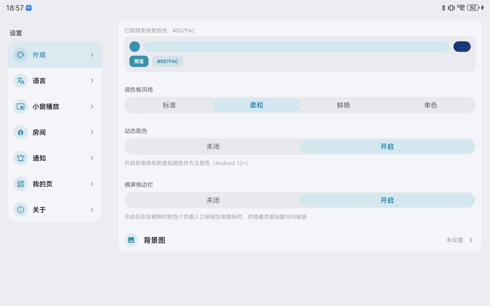
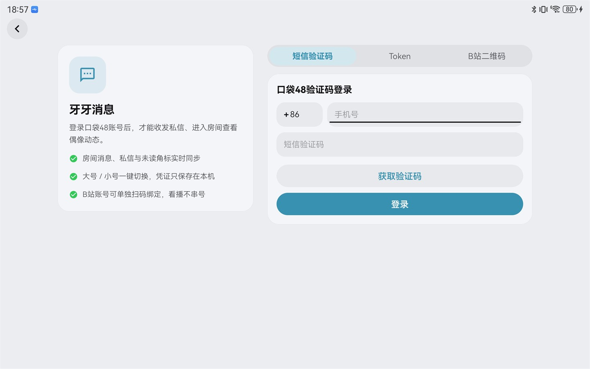
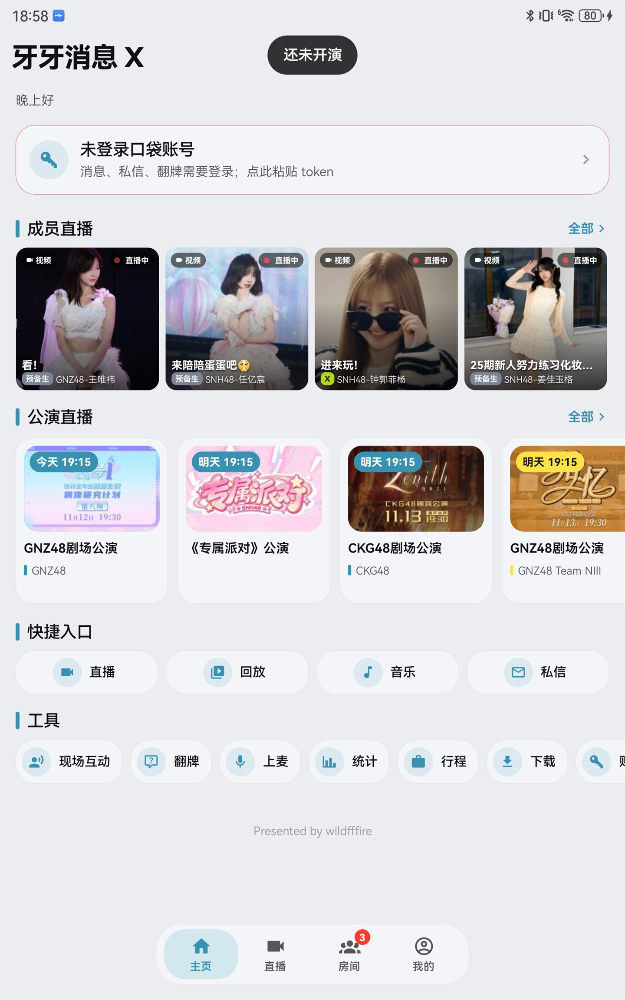

<p align="center">
  
</p>
<p align="center">
  
</p>

<p align="center">
  <a href="LICENSE"></a>
  <a href="https://github.com/wildfffire/yaya_msg_mobileX/releases"></a>
  
  
</p>

# 牙牙消息 X

口袋48 / SNH48 Group 的**第三方 Android 客户端**，用 React Native 编写：进入成员房间看消息、看直播与回放、听歌看视频、翻牌私信。**横屏平板 / 大屏优先**，持续优化房间与直播体验。

**横屏侧边栏**是这一版的主推交互：转到横屏后，四个页面入口收进屏幕左侧一条**完全透明的纯图标窄栏**（设置 → 外观 → 横屏侧边栏 可开关），顶部头像直达账号中心，页面大标题与问候语统统让位给内容。竖屏或关掉开关时保持原来的底部胶囊。截图与细节见下方[「横屏侧边栏」](#横屏侧边栏)。

- 上游基础：[Xenia0922/yaya_msg_mobile](https://github.com/Xenia0922/yaya_msg_mobile)，再往上溯源去 [yk1z/yaya_msg](https://github.com/yk1z/yaya_msg)
- 自 v2.7.5 起由 [@wildfffire](https://github.com/wildfffire) 独立维护，更新路线与上游分离
- 仅支持 Android（原生工程已入库，不做 iOS 适配）

## 横屏侧边栏

> 横屏时的主推交互：底部胶囊导航换成左侧一条**透明纯图标窄栏**，大标题与问候语一起让位，横向空间全部留给内容。竖屏或关掉开关时像素级回退原来的底部胶囊，两套布局互不干扰。

<table>
<tr>
<td width="50%"></td>
<td width="50%"></td>
</tr>
<tr>
<td align="center">主页 · 无大标题、无问候语，内容直接顶到页头</td>
<td align="center">房间 · 侧栏图标带未读角标，与列表的大 / 小房间角标同源</td>
</tr>
<tr>
<td></td>
<td></td>
</tr>
<tr>
<td align="center">直播 · 卡片按扣掉侧栏后的可用宽度排版，不挤不乱</td>
<td align="center">我的 · 账号卡 / 快捷入口 / 观看历史从页头开始，右侧操作贴边</td>
</tr>
<tr>
<td></td>
<td></td>
</tr>
<tr>
<td align="center">设置 → 外观 → 横屏侧边栏（关闭 / 开启，默认关）</td>
<td align="center">点侧栏顶部头像直达账号中心（未登录时是登录页）</td>
</tr>
</table>

<p><sub>截图取自 1024×640dp 横屏平板（1600×2560 @400dpi），浅色主题；页面里的成员直播与公演排期为实时数据。</sub></p>

### 开关与生效条件

| 场景 | 表现 |
|:--|:--|
| 横屏 + 开关打开 | 左侧纯图标侧栏，页面内容左移让出 46–68dp |
| 竖屏（开关开着也一样） | 回退底部胶囊 + 大标题 + 问候语 |
| 横屏 + 开关关闭 | 回退底部胶囊 |
| 老版本存档没有该字段 | 按关闭处理（默认关） |

- 开关位置：**设置 → 外观 → 横屏侧边栏**（关闭 / 开启）
- 判定只认严格布尔 `true`，`1` / `'true'` 之类不会误开
- 进入二级页、房间、播放器时侧栏整体不渲染，场景也不留白

### 侧栏构成

- **顶部头像**：当前账号头像（36dp，随栏宽自适应），点击直达**账号中心**；未登录时显示占位图标
- **左下四入口**：主页 / 直播 / 房间 / 我的，纯图标 23dp，单元 40dp、间距 2dp、离底 36dp（避开系统手势条）
- **选中态**：点亮主题色并轻微弹一下（spring 1.16 → 1），不做底板高亮
- **未读角标**：房间入口显示本地累计的房间未读数（大 + 小两侧之和），超过 99 显示 `99+`
- **唯一分区**：一条上下留白的 hairline 细竖线 —— 不用玻璃、不铺底板、不加阴影、不做 BlurView

### 尺寸自适应

侧栏宽度按**屏幕短边**计算（`sidebarMetrics()`），侧栏本体、场景左移、首页网格三处共用同一个真值：

| 设备 | 内容宽 + 安全边 | 让出总宽 |
|:--|:--|:--|
| 平板 1024×640dp | 48 + 10 | 58dp |
| 手机横屏 851×393dp | 40 + 6 | 46dp |
| 大平板 1280×800dp | 56 + 12 | 68dp |

- 内容宽夹在 40–56dp、安全边夹在 4–12dp，异常尺寸也不会算出 NaN
- 旧版固定 96dp 的「又宽又空的白带」已彻底下线
- 首页的快捷入口与成员直播按**扣掉侧栏后**的可用宽度算格子，成员直播硬锁一行不换行

### 页头与滚动

- 全站页面标题在 `ScreenHeader` 一处收口：侧栏模式下标题整块换成零高度占位，页头只留状态栏 + 返回键/右侧按钮（`minHeight: 50`），32 个调用点无需逐个改
- 首页问候语整行不渲染（不是置空，避免残留空白）
- 侧栏**常驻**，不参与「向上滚动收起」的滑出动画 —— 那套 `DOCK_TRAVEL` 位移是为底部胶囊设计的，套在侧栏上会把整条栏推出屏幕

### 竖屏对照

<p align="left">
  
</p>

竖屏（或关掉开关）保持原来的大标题 + 问候语 + 底部玻璃胶囊，与侧栏模式互不影响。

### 实现位置

| 文件 | 职责 |
|:--|:--|
| `src/utils/sidebarMode.ts` | 纯规则：`sidebarModeActive()` 判定 + `sidebarMetrics()` 尺寸（唯一真值，可进 Node 单测） |
| `src/hooks/useSidebarMode.ts` | `useSidebarMode` / `useSidebarMetrics`，旋转后让已挂载页面一起重算 |
| `src/components/AppSideBar.tsx` | 侧栏本体（头像、四个图标、角标、hairline） |
| `src/navigation/index.tsx` | 底栏与侧栏分流；`sceneStyle.paddingLeft` 与侧栏共用宽度 |
| `src/components/ScreenHeader.tsx` | 全站页面标题收口（32 个调用点） |
| `src/screens/HomeScreen.tsx` | 问候语隐藏 + 快捷入口/成员直播按可用宽度排版 |
| `src/screens/SettingsScreen.tsx` | 设置 → 外观里的开关 UI |
| `scripts/sidebar-mode.test.mjs` | 18 项回归锁（纯规则 + 单一真值源静态接线） |

### 回归锁

`scripts/sidebar-mode.test.mjs` 已并入 `npm run test:core`：横屏/竖屏 × 开关开/关四种组合、三档真机尺寸、老存档默认关，以及「侧栏 / 导航 / 首页都必须用 `useSidebarMetrics()`、禁止再出现固定宽度常量」的静态接线锁。

## 项目定位

- **不定期与上游同步功能**：上游（[yk1z/yaya_msg](https://github.com/yk1z/yaya_msg) 等）新增的能力会**按需择期回移**，不做逐版本跟随，也不承诺与上游功能完全对齐
- **主要面向横屏的平板 / 大屏场景**：布局、控制坞、弹幕与多列信息都按横屏优先设计，横屏专用的左侧图标侧栏是默认主推的导航形态（可开关），手机竖屏可用但不是主要目标
- **主要优化房间与直播体验**：房间消息、未读、房间内直播与回放、播放器与弹幕是持续投入的方向
- **翻牌、礼物等功能：具体情况未知**：这部分**尽可能复用了上游已有的优化实现，但未做测试** —— 是否可用、行为是否与上游一致都无法保证，遇到问题欢迎反馈

## 接下来的开发目标

- **更多个性化选择**：把「能调的都做成可选项」——头像来源（房间内 / 房间外）、播放器行为、界面信息密度、列表与弹幕展示等会继续拆成独立开关，优先满足「按自己的习惯用」
- 主线不变：仍以横屏平板场景下的**房间与直播体验**为优化重点（见上方「项目定位」）

## 相对上游的主要变化

- **横屏侧边栏**：横屏时可把四个页面入口收进左侧透明纯图标栏（顶部头像进账号中心、房间未读角标、宽度按屏幕短边自适应），页面标题与问候语让位给内容，竖屏仍用底部胶囊
- **播放器统一**：主直播页、房间内、观看历史、稍后再看共用一套会话层（解析 / 续播 / 在线人数 / 弹幕 / 公告 / 小窗），一套 UI 覆盖直播、回放、录播视频、公演直播、电台与直链播放
- **账号中心**：一套「Hero 账号横幅 + 分区列表」的账号页（宽屏左身份右内容），点头像 / 昵称直接弹窗改资料，大小号切换、余额充值、签到与 B站绑定都在同一页
- **房间**：关注成员房间（大房间 / 小房间分侧未读角标）、引用回复与翻牌渲染、房间公告、礼物特效与公屏、房间内直播与回放、点封面直接进房间内直播
- **公演**：公演排期卡条（未来 10 天），已开演场次 **B站优先**，B站未开播才走应用内信号
- **成员**：自建成员库镜像（每日同步 + 人工修正）、成员档案就地内嵌、成员动态、鸡腿榜
- **观看历史 / 稍后再看**：同一直播只留一条记录，退出播放回到来源列表页
- **面板语言统一**：贡献榜 / 礼物 / 弹幕列表 / 弹幕设置共用一套黑白深色抽屉（同一抬头、同一圆角与遮罩），横屏统一贴右
- **体验**：全局横竖屏、深色 / 浅色 / 跟随系统一键切换、多套主题配色（主题色 / 强调色）、中 / 繁 / 英 / 日 / 韩五语言、画中画与小窗、进入播放器自动隐藏系统栏
- **工程**：出包脚本化（默认仅 arm64-v8a）、版本号三处一致性校验、纯 Node 回归测试

## 最近更新（Build 3000047）

- **横屏侧边栏（新）**：设置 → 外观新增「横屏侧边栏」开关（默认关）。横屏时底部胶囊换成左侧**完全透明的纯图标栏**，顶部头像直达账号中心、房间入口带本地未读角标；页面大标题与首页问候语一起隐藏，页头收紧到状态栏高度。宽度按屏幕短边自适应（46–68dp），侧栏 / 场景左移 / 首页网格共用同一真值；竖屏或关掉开关时像素级回退原来的底部胶囊。
- **账号中心重做**：旧登录页换成「Hero 账号横幅 + 分区列表」。平板 / 横屏是左右双栏（左身份 + 导航，右分区），手机单列；点头像或昵称弹「编辑资料」改头像与昵称，列表里不再散着头像 / 昵称 / 改名次数三行。
- **分区收敛为 4 个**：账号切换（含主号 / 小号网格与注销）、鸡腿充值、自动签到、B站账号。停用「登录状态 / 账号 ID / Token」三行冗余展示，账号列表也不再每行重复同一个 Token。
- **播放器功能面板**：去掉「进入房间」与「小窗」入口；横屏改为右侧竖排抽屉。公告只从该面板移除，顶栏喇叭与公告面板照旧。
- **礼物 / 贡献榜**：面板改成与弹幕列表同一套黑白深色抽屉，横屏贴右；修复列表被屏幕裁掉、底部留大片空白的问题（列表现在有确定高度并可滚动）。
- **播放速度**：从整屏弹层改成右下角下拉菜单；**暂停钮样式**默认 Glass，切换后记住选择。
- **沉浸播放**：进入播放器即隐藏设备状态栏与导航栏，关闭时恢复。
- **弹幕**：飘屏条目可直接点开发送者资料卡（直播与房间都支持，回放 LRC 无身份不触发）；贡献榜行、弹幕列表发送者同样可点。弹幕设置面板去掉顶部小条、开关与胶囊改细长、关闭按钮靠右。
- **「我的」页**：运行日志与成员数据迁入设置 → 关于（成员数据固定置底），现场互动移到首页工具第一位，右上角新增「跟随系统 / 浅色 / 深色」一键切换。
- **充值页**：去掉页头余额卡只留官方网页，右上角保留一个刷新按钮。

## 功能

| 模块 | 内容 |
|:--|:--|
| 导航 | 底部玻璃胶囊；横屏可切换为左侧透明纯图标侧栏（头像进账号中心、房间未读角标、宽度自适应），向上滚动收起底栏 |
| 房间 | 关注成员房间、实时消息、未读角标、引用回复与翻牌、房间公告、礼物特效、房间内直播 / 回放、房间电台 |
| 直播 | 口袋直播与回放、B站直播间、公演排期直播、弹幕（飘屏 / 抽屉 / 发送 / 设置，飘屏可点进资料卡）、在线人数、续播定位、倍速下拉、小窗与画中画 |
| 媒体 | 官方音乐库、视频库、电台节目、观看历史、稍后再看、下载管理 |
| 成员 | 成员库、成员档案、成员动态、鸡腿榜、公演记录 |
| 账号 | 账号中心（Hero + 分区）、验证码登录、Token 登录与校验、大小号切换、资料弹窗编辑、私信、翻牌统计、充值、开发票 |
| 其他 | 深色 / 浅色 / 跟随系统、主题配色、横竖屏、五语言、图片查看器、运行时日志、清除缓存 |

## 安装

从 [Releases](https://github.com/wildfffire/yaya_msg_mobileX/releases) 下载 APK。

文件名为 `yaya-msg-mobile-v<版本>-b<小版本>-<abi>.apk`，例如 `yaya-msg-mobile-v3.0.0-b3000047-v8a.apk`：

- **v8a**（arm64-v8a）：真机使用，默认只提供这一个
- **x86_64**：模拟器专用，需要时自行构建

文件名只用于区分，不影响安装 —— Android 只校验 APK 内的 versionCode 与签名。

## 兼容

- Android 8.0+（minSdk 26）
- HarmonyOS 2 / 3 / 4 可安装（Android 基座为 8–10）
- 模拟器需安装 x86_64 包，否则无法启动

## 构建

### 环境

- Node.js 20+（CI 使用 22）
- JDK 17+
- Android SDK / NDK（版本见 `android/build.gradle`）

### 命令

```sh
npm install --legacy-peer-deps

npm run typecheck     # tsc + 版本号一致性校验
npm run test:core     # 纯 Node 回归测试（不依赖 jest）

node scripts/build-apk.js
```

默认只构建 **arm64-v8a**，产物复制到 `~/yaya-apk/yaya-msg-mobile-v<版本>-b<小版本>-v8a.apk`。

按需调整：

```sh
node scripts/build-apk.js                        # arm64-v8a（默认）
YAYA_ABIS=x86_64 node scripts/build-apk.js       # 模拟器
YAYA_ABIS=arm64-v8a,x86_64 node scripts/build-apk.js
YAYA_UNIVERSAL=true node scripts/build-apk.js    # universal
YAYA_APK_OUT_DIR=D:/out node scripts/build-apk.js # 自定义输出目录
```

### 签名

正式出包需要在 `~/.gradle/gradle.properties` 或环境变量中提供：

```
RELEASE_STORE_FILE
RELEASE_STORE_PASSWORD
RELEASE_KEY_ALIAS
RELEASE_KEY_PASSWORD
```

未提供时 release 包会回落到 debug 签名（脚本会打印警告）。仓库内**不含任何密钥**，`android/local.properties` 也不入库。

### 开发调试

```sh
npm start          # Metro
npm run android    # expo run:android
```

## 版本号约定

三处必须同步，否则 `npm run verify:version`（已并入 `npm run typecheck`）会失败：

| 位置 | 字段 |
|:--|:--|
| `app.json` | `expo.version` / `expo.android.versionCode` |
| `android/app/build.gradle` | `versionName` / `versionCode` |
| `src/constants/index.ts` | `APP_VERSION` / `APP_BUILD` |

`APP_BUILD` 即 Android versionCode（设置页显示为 `Build {n}`）。

## 项目结构

```
android/     原生工程，含自定义 Kotlin 模块（云信 IM / 聊天室 / 圈组、播放器控制）
assets/      图标、启动图、成员库离线快照、README 截图（screenshots/）
docs/        接口映射、设计系统、重构方案等内部文档
member-db/   成员库同步脚本与产物（App 通过 jsDelivr 拉取 dist/members.json）
modules/     本地原生模块（liquid-glass-native）
scripts/     出包、版本校验、回归测试
src/
  api/         口袋48 / B站 / 官方媒体接口
  auth/        pa 签名（WASM）
  components/  通用组件（含 AppSideBar 横屏侧边栏、ScreenHeader、统一播放器 UI）
  hooks/       通用 hooks（useSidebarMode 侧栏判定/尺寸）
  i18n/        多语言
  native/      原生桥接
  navigation/  导航与 Tab（底部胶囊 / 侧栏分流）
  player/      统一播放器（core / chrome / resolve / session / store）
  screens/     页面（含 room/ 房间、watch/ 历史与稍后再看）
  services/    业务服务（成员库、未读、历史、设置、云信等）
  store/       全局状态（zustand）
  theme/       主题与设计 token
  utils/       纯函数与规则
```

## 技术栈

React Native 0.83.10 · Expo 55 · TypeScript 5.9 · zustand · react-native-video · react-native-reanimated 4 · @kesha-antonov/react-native-chat · react-native-webview · 自研 Kotlin 原生模块

## 已知限制

- B站直播间**没有实时在线人数**：`room/v1/Room/get_info` 的 `online` 恒为 0，`getInfoByRoom` 被风控拒绝，页面只能显示关注数
- 房间未读为**本地累计**方案，App 未运行期间的消息不计入
- 只维护 Android，不提供 v7a / universal 预编译包

## 反馈

- 问题与建议：[Issues](https://github.com/wildfffire/yaya_msg_mobileX/issues)
- 提交代码前请确保 `npm run typecheck` 与 `npm run test:core` 全绿

## 致谢

- [yk1z/yaya_msg](https://github.com/yk1z/yaya_msg)：项目最初的源头
- [Xenia0922/yaya_msg_mobile](https://github.com/Xenia0922/yaya_msg_mobile)：本项目的直接上游基础
- 以及所有开源依赖的作者

## 免责声明

本应用为**非官方第三方客户端**，与丝芭传媒（SNH48 Group）及口袋48 官方无任何关联，未获得其授权或认可，请以官方客户端为准。

- 应用展示的直播、视频、音乐、图片、文本等内容版权归原权利人所有
- 本项目仅用于个人技术学习与交流，不代表任何官方立场，不保证内容持续可用
- 请勿将本应用及其内容用于商业用途或任何盈利活动
- 使用本应用可能产生的风险（含账号安全风险）由使用者自行承担
- 如内容涉及侵权或您认为不妥，请联系仓库维护者处理

## 许可

[GPL-3.0](LICENSE)
